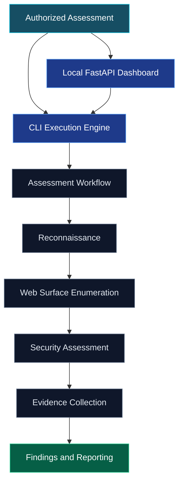
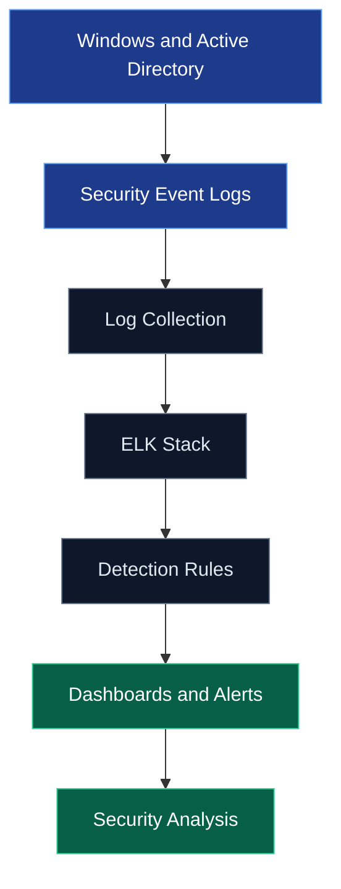

<!-- ====================================================== -->
<!-- YASSINE EL AMRANI | CYBERSECURITY ENGINEER             -->
<!-- GitHub Profile README | Professional Cyber Portfolio  -->
<!-- ====================================================== -->

### Cybersecurity Engineer

**Junior Security Consultant, Penetration Testing and Cyber Defense**

 

  

---

## 🛡️ About Me

I'm a **Cybersecurity Engineer** currently working as a **Junior Cybersecurity Consultant at NEWERACOM**, focusing on offensive and defensive security.

My work includes web and network penetration testing, vulnerability assessments, security audits, SOC and SIEM monitoring, threat detection, incident response, and infrastructure hardening.

I also develop security automation workflows and have worked on Active Directory attack detection, security validation, evidence collection, and technical reporting.

My main interests are penetration testing, cyber defense, security engineering, DevSecOps, and building practical tools that help organizations identify and reduce security risks.

 

### 
Security Operations Profile

 

<table align="center">
<thead>
<tr>
<th align="center">SECURITY DOMAIN</th>
<th align="center">CORE CAPABILITIES</th>
<th align="center">TECHNICAL FOCUS</th>
</tr>
</thead>

<tbody>
<tr>
<td align="center" valign="middle">

</td>
<td align="left" valign="middle">

Penetration Testing 
Vulnerability Assessment 
Web and Network Security

</td>
<td align="left" valign="middle">

Reconnaissance 
Enumeration 
Security Validation

</td>
</tr>

<tr>
<td align="center" valign="middle">

</td>
<td align="left" valign="middle">

SOC and SIEM Monitoring 
Threat Detection 
Incident Response

</td>
<td align="left" valign="middle">

Log Analysis 
Active Directory Security 
Security Hardening

</td>
</tr>

<tr>
<td align="center" valign="middle">

</td>
<td align="left" valign="middle">

Python and Bash 
Security Tool Integration 
DevSecOps

</td>
<td align="left" valign="middle">

Workflow Automation 
Evidence Collection 
Technical Reporting

</td>
</tr>
</tbody>
</table>

 

  

Professional security capabilities across offensive security, cyber defense, and automation.

 

---

## 🚀 Featured Projects

### 01. [APAWA/PTF, Automated Web Application Pentesting Framework](https://github.com/elamraniyassine02/automated-web-pentesting-framework)

A Python-based framework for structured and authorized web application security assessments.

It combines a CLI execution engine with a local FastAPI dashboard for assessment planning, reconnaissance, web surface enumeration, bounded security validation, evidence collection, and professional reporting.

**Key Capabilities**

- Eight-phase security assessment methodology.
- Passive and active reconnaissance.
- Web surface enumeration and vulnerability assessment.
- Integration of security tools and assessment workflows.
- Evidence collection and normalized findings.
- Automated technical reporting.
- Local dashboard with controlled execution.

<b>🔎 Explore Technical Architecture and Capabilities</b>

 

#### System Architecture

#### Assessment Modules

<table align="center">
<thead>
<tr>
<th align="center">PHASE</th>
<th align="center">SECURITY ACTIVITY</th>
<th align="center">TECHNICAL FOCUS</th>
</tr>
</thead>
<tbody>
<tr><td align="center">01</td><td>Engagement Setup</td><td>Scope and authorization</td></tr>
<tr><td align="center">02</td><td>Passive Reconnaissance</td><td>OSINT, DNS and asset discovery</td></tr>
<tr><td align="center">03</td><td>Active Reconnaissance</td><td>Nmap, service discovery and HTTP probing</td></tr>
<tr><td align="center">04</td><td>Web Enumeration</td><td>Katana, FFUF and surface discovery</td></tr>
<tr><td align="center">05</td><td>Security Assessment</td><td>Configuration and vulnerability checks</td></tr>
<tr><td align="center">06</td><td>Traffic Validation</td><td>HTTP analysis and bounded validation</td></tr>
<tr><td align="center">07</td><td>Evidence Preparation</td><td>Evidence records and structured findings</td></tr>
<tr><td align="center">08</td><td>Reporting</td><td>Technical assessment reports</td></tr>
</tbody>
</table>

#### Technology Stack

**Backend**

**Reconnaissance**

**Web Enumeration**

**Security Assessment**

**Reporting**

#### Security Principles

- Authorized assessment scope.
- Controlled execution.
- Bounded security validation.
- Analyst review.
- Evidence-first reporting.
- Local-only dashboard.

 

 

---

### 02. [AI-Driven Security Framework](https://github.com/elamraniyassine02/AI-DRIVEN-SECURITY)

A cybersecurity monitoring project focused on log analysis, Active Directory attack detection, and security visibility using ELK Stack and related security technologies.

**Key Areas**

- Active Directory security monitoring.
- Centralized log collection and analysis.
- SIEM dashboards and detection rules.
- Brute-force, Pass-the-Hash, Kerberoasting, and AS-REP Roasting scenarios.
- Threat analysis and security investigation.

<b>🔎 Explore Detection Engineering Workflow</b>

 

This project connects offensive security scenarios with defensive monitoring and detection engineering.

 

 

---

### 03. [DevSecOps Vulnerability Analysis](https://github.com/elamraniyassine02/studio)

A project exploring vulnerability assessment and security testing within development and deployment workflows.

**Focus**

- Container security.
- Vulnerability analysis.
- Security checks in CI/CD workflows.
- Secure development practices.
- DevSecOps automation.

 

 

---

<b>📂 Other Projects</b>

 

### [uemfCoin, Custom Blockchain](https://github.com/elamraniyassine02/tp-exam-blockchain)

A Proof-of-Work blockchain project developed with Node.js, covering transactions, wallets, block mining, and API integration.

---

## ⚒️ Technologies & Tools

### 🔴 Offensive Security

 

### 🔵 SOC, SIEM & Cyber Defense

 

### ⚙️ Automation & DevSecOps

 

### 💻 Systems & Development

 

---

## 🐉 GitHub Contributions

 

GitHub contribution visualization generated from recorded activity.

 

<b>📊 Explore Contribution Activity</b>

 

View my contribution history and activity directly on my GitHub profile.

---

## ⚡ Stats

 

  

  

 

<b>📈 About These Statistics</b>

 

- Language distribution reflects repository contents, not programming proficiency.
- GitHub contribution history depends on recorded activity and visibility settings.
- Badges and charts use external services and may occasionally show cached data.
- The official GitHub profile remains the source of record for contribution history.

---

## 📡 Connect With Me

**Interested in cybersecurity, security automation, or technical collaboration?**

I'm open to professional discussions, cybersecurity projects, and collaboration with security teams and engineers.

 

  

